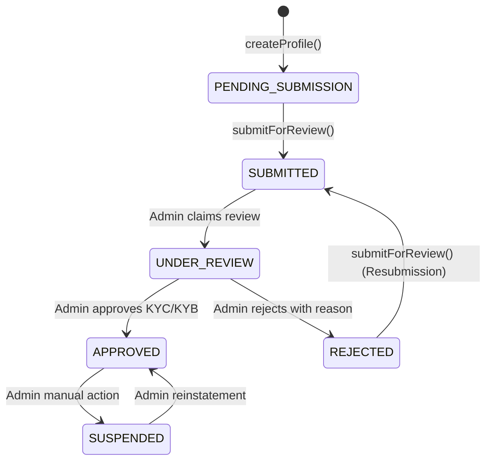

# SmartPay Malawi — Merchant Architecture & Module Specification

> **Document:** Merchant Module Architecture & API Specification  
> **Backend:** NestJS (Node.js / TypeScript / ESM)  
> **Module Path:** `src/merchants`  
> **Database:** PostgreSQL via Prisma ORM  
> **Authentication:** Bearer / HTTP-Only Cookie JWT (`JwtAuthGuard`)  
> **Status:** Active / In Development  

---

## 1. Overview & Purpose

The **Merchant Module** (`src/merchants`) encapsulates business identity onboarding, compliance data collection (KYC/KYB), profile maintenance, and payout destination management (settlement accounts) for the SmartPay Malawi platform.

### Core Separation: Authentication vs. Business Identity

SmartPay enforces an intentional architectural separation between an **Auth Account** and a **Merchant Business Profile**:

```text
┌────────────────────────────────────────┐
│               Merchant                 │ (Authentication Entity)
│  - id: UUID                            │
│  - email, phone, passwordHash          │
│  - status: PENDING | ACTIVE | SUSPENDED│
└───────────────────┬────────────────────┘
                    │ 1:1 (Optional Onboarding)
                    ▼
┌────────────────────────────────────────┐
│            MerchantProfile             │ (Business & Compliance Entity)
│  - id: UUID, merchantId: UUID          │
│  - businessName, registrationNo, TPIN  │
│  - accountStatus: PENDING_SUBMISSION...│
└───────────┬────────────────┬───────────┘
            │ 1:N            │ 1:N
            ▼                ▼
┌──────────────────────┐  ┌───────────────────────────┐
│  SettlementAccount   │  │     MerchantDocument      │
│  - Airtel Money      │  │  - Certificate of Incorp  │
│  - TNM Mpamba        │  │  - National ID / TPIN     │
│  - Bank Transfer     │  │  - Proof of Address       │
└──────────────────────┘  └───────────────────────────┘
```

1. **Lightweight Registration:** A user registers via the Auth module with basic credentials (`email`, `phone`, `password`). At this stage, no business profile is required.
2. **Progressive Onboarding:** The merchant subsequently submits business registration, tax identification numbers, physical address, KYC documents, and settlement accounts at their own pace.
3. **Admin Review Lifecycle:** Only after the merchant explicitly submits their profile (`POST /merchants/profile/submit`) does the profile enter the admin review queue.

---

## 2. Directory Structure

```text
src/merchants/
├── dto/
│   ├── add-settlement-account.dto.ts  # Validation for Airtel, Mpamba, and Bank payouts
│   ├── create-profile.dto.ts          # Validation for business identity creation
│   └── update-profile.dto.ts          # PartialType DTO for merchant profile edits
├── entities/
│   └── merchant.entity.ts             # Domain entity placeholder
├── merchants.controller.spec.ts       # Controller unit tests
├── merchants.controller.ts            # REST endpoints with JwtAuthGuard & CurrentUser
├── merchants.module.ts                # NestJS module definition with DatabaseModule
├── merchants.service.spec.ts          # Service unit tests
└── merchants.service.ts               # Core business logic and database interactions
```

---

## 3. Account & Onboarding Lifecycle State Machine

A merchant's profile progresses through distinct states managed by `AccountStatus`:



### State Definitions

| State | Who Controls | Description |
|---|---|---|
| `PENDING_SUBMISSION` | Merchant | Default initial state. The merchant can create/update details, upload documents, and configure settlement accounts. |
| `SUBMITTED` | Merchant | Merchant has finalized details and requested approval. Profile data is locked against inadvertent edits. |
| `UNDER_REVIEW` | Admin | Compliance team is actively auditing documents and verifying business legitimacy. |
| `APPROVED` | Admin | KYC/KYB cleared. The merchant is authorized to process live transactions and payouts. |
| `REJECTED` | Admin | Missing or invalid documents/data. A `rejectionReason` is recorded; the merchant can correct data and resubmit. |
| `SUSPENDED` | Admin | Compliance breach, fraud trigger, or risk hold. |

---

## 4. API Endpoints

All endpoints in `MerchantsController` are guarded by `JwtAuthGuard`. The authenticated merchant's UUID is extracted directly from the verified token using `@CurrentUser('userId')` to guarantee strict multi-tenant data isolation.

### Endpoint Matrix

| Method | Endpoint | Description | Guards / Auth |
|---|---|---|---|
| `POST` | `/merchants/profile` | Create the initial business profile | `JwtAuthGuard` |
| `GET` | `/merchants/profile` | Retrieve the authenticated merchant's profile | `JwtAuthGuard` |
| `PATCH` | `/merchants/profile` | Update editable profile fields | `JwtAuthGuard` |
| `POST` | `/merchants/profile/submit` | Submit profile for administrative review | `JwtAuthGuard` |
| `GET` | `/merchants/settlement-accounts` | List all configured payout accounts | `JwtAuthGuard` |
| `POST` | `/merchants/settlement-accounts` | Add a mobile money or bank settlement account | `JwtAuthGuard` |
| `DELETE` | `/merchants/settlement-accounts/:id` | Remove a payout account by ID | `JwtAuthGuard` |

---

## 5. Detailed Component Specifications

### 5.1 Business Profile Creation & Management

#### `createProfile(merchantId, dto: CreateProfileDto)`
- **Route:** `POST /merchants/profile`
- **Behavior:**
  - Enforces the 1:1 relationship between `Merchant` and `MerchantProfile`. If a profile already exists for the merchant, throws `ConflictException('Profile already exists')`.
  - Persists business metadata: `businessName`, `tradingName`, `businessType` (e.g., `SOLE_PROPRIETORSHIP`, `PARTNERSHIP`, `LIMITED_COMPANY`, `NGO`), `businessRegistrationNo`, `taxIdentificationNo`, `merchantCategoryCode`, support channels (`supportEmail`, `supportPhone`, `websiteUrl`), and location (`addressLine1`, `addressLine2`, `city`, `district`, `country`).
  - Sets default `accountStatus` to `PENDING_SUBMISSION`.

#### `getMyProfile(merchantId)`
- **Route:** `GET /merchants/profile`
- **Behavior:**
  - Queries `merchantProfile` by unique `merchantId`.
  - Includes eager relations: `documents` (KYC uploads) and `settlementAccounts`.
  - Throws `NotFoundException('Profile not found')` if no profile has been initialized yet.

#### `updateProfile(merchantId, dto: UpdateProfileDto)`
- **Route:** `PATCH /merchants/profile`
- **Behavior:**
  - Uses `UpdateProfileDto` (derived via NestJS `PartialType(CreateProfileDto)`).
  - Permits updates only to merchant-editable metadata fields.
  - **Security Guardrail:** Does not allow modification of administrative fields (`accountStatus`, `approvedAt`, `approvedById`, `rejectionReason`).

---

### 5.2 Review Submission Flow

#### `submitForReview(merchantId)`
- **Route:** `POST /merchants/profile/submit`
- **Rules:**
  - The profile must exist (`NotFoundException` otherwise).
  - Can **only** be submitted if `accountStatus` is currently `PENDING_SUBMISSION` or `REJECTED` (for resubmissions after addressing compliance feedback).
  - If called from any other state (`SUBMITTED`, `UNDER_REVIEW`, `APPROVED`), throws `BadRequestException('Cannot submit from status: ...')`.
  - Updates:
    - `accountStatus = 'SUBMITTED'`
    - `submittedAt = new Date()`
    - `rejectionReason = null` (clears previous failure message)

---

### 5.3 Settlement Accounts (Payouts)

Settlement accounts define where merchant balances are disbursed. SmartPay accommodates the Malawian payments landscape:

1. **Airtel Money** (`AIRTEL_MONEY`)
2. **TNM Mpamba** (`TNM_MPAMBA`)
3. **Commercial Bank Transfers** (`BANK_TRANSFER`)

#### Multi-Tier Validation Pattern
Validation is implemented in two defensive layers:

1. **Declarative DTO Layer (`AddSettlementAccountDto`)**:
   Uses `class-validator`'s `@ValidateIf()` decorator:
   - For `AIRTEL_MONEY` or `TNM_MPAMBA`, `phoneNumber` is validated.
   - For `BANK_TRANSFER`, `bankName`, `accountName`, and `accountNumber` are validated.
2. **Service Defensive Layer (`addSettlementAccount`)**:
   Explicit conditional validation throws clean, descriptive `BadRequestException` errors:
   - `"bankName, accountName, and accountNumber are required for bank transfers"`
   - `"phoneNumber is required for mobile money accounts"`

#### Primary Account Management (`isPrimary`)
- When a new account is registered with `isPrimary: true`, the service runs a pre-emptive batch update:
  ```typescript
  await this.databaseService.settlementAccount.updateMany({
    where: { profileId: profile.id },
    data: { isPrimary: false },
  });
  ```
- This guarantees that exactly one primary account exists per merchant without race conditions.

#### Tenant-Isolated Deletion
- **Route:** `DELETE /merchants/settlement-accounts/:id`
- Verifies that `accountId` is owned by the caller's `profileId`:
  ```typescript
  const account = await this.databaseService.settlementAccount.findFirst({
    where: {
      id: accountId,
      profileId: profile.id, // Strictly scoped
    },
  });
  ```
- Throws `NotFoundException('Settlement account not found')` if missing or belonging to another merchant, preventing IDOR (Insecure Direct Object Reference) vulnerabilities.

---

## 6. Data Models & Relationships (Prisma)

```prisma
model MerchantProfile {
  id                     String         @id @default(uuid()) @db.Uuid
  merchantId             String         @unique @db.Uuid
  businessName           String
  tradingName            String?
  businessType           BusinessType
  businessRegistrationNo String?
  taxIdentificationNo    String?
  merchantCategoryCode   String?
  industryDescription    String?

  supportEmail           String?
  supportPhone           String?
  websiteUrl             String?
  addressLine1           String?
  addressLine2           String?
  city                   String?
  district               String?
  country                String         @default("MW")

  logoUrl                String?
  accountStatus          AccountStatus  @default(PENDING_SUBMISSION)
  rejectionReason        String?
  approvedAt             DateTime?
  approvedById           String?
  submittedAt            DateTime?

  createdAt              DateTime       @default(now())
  updatedAt              DateTime       @updatedAt

  merchant               Merchant       @relation(fields: [merchantId], references: [id], onDelete: Cascade)
  documents              MerchantDocument[]
  settlementAccounts     SettlementAccount[]
  reviewHistory          MerchantReviewHistory[]

  @@map("merchant_profiles")
}
```

---

## 7. Security & Compliance Principles

1. **Zero Tenant Bleed:**  
   Every query filters strictly on `merchantId` extracted from the cryptographically verified JWT (`req.user.userId`). Route parameters like `:merchantId` are forbidden on self-service merchant endpoints.
2. **Administrative Boundary:**  
   Merchant operations cannot alter audit or status columns directly. Approval, rejection, and suspension occur strictly via the administrative module (`src/admin`).
3. **Data Integrity for Payouts:**  
   Settlement accounts cannot be edited in-place; they are added and deleted. This maintains audit logs for financial records and AML/KYC tracking.
4. **Malawi E.164 Formatting:**  
   Phone numbers adhere to international/Malawian numbering standards (`+265` or 9-digit format) to ensure interoperability with mobile network operator payout APIs.
