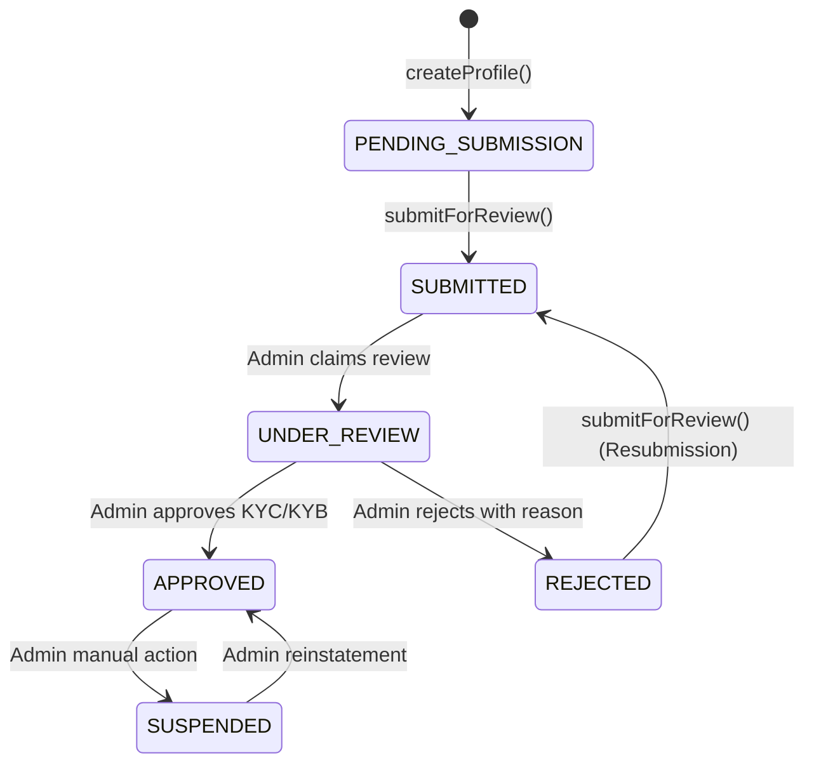

# SmartPay Malawi — Merchant Architecture & Module Specification

> **Document:** Merchant Module Architecture & API Contract  
> **Backend:** NestJS (Node.js / TypeScript / ESM)  
> **Module Path:** `src/merchants`  
> **Database:** PostgreSQL via Prisma ORM  
> **Authentication:** Bearer / HTTP-Only Cookie JWT (`JwtAuthGuard`)  
> **Base URL:** `http://localhost:3000` (development)  
> **Status:** Active / In Development  

---

## 1. Overview & Purpose

The **Merchant Module** (`src/merchants`) encapsulates business identity onboarding, compliance data collection (KYC/KYB), profile maintenance, and payout destination management (settlement accounts) for the SmartPay Malawi platform.

### Core Separation: Authentication vs. Business Identity

SmartPay enforces an intentional architectural separation between an **Auth Account** and a **Merchant Business Profile**:

```text
┌────────────────────────────────────────┐
│               Merchant                 │ (Authentication Entity)
│  - id: UUID                            │
│  - email, phone, passwordHash          │
│  - status: PENDING | ACTIVE | SUSPENDED│
└───────────────────┬────────────────────┘
                    │ 1:1 (Optional Onboarding)
                    ▼
┌────────────────────────────────────────┐
│            MerchantProfile             │ (Business & Compliance Entity)
│  - id: UUID, merchantId: UUID          │
│  - businessName, registrationNo, TPIN  │
│  - accountStatus: PENDING_SUBMISSION...│
└───────────┬────────────────┬───────────┘
            │ 1:N            │ 1:N
            ▼                ▼
┌──────────────────────┐  ┌───────────────────────────┐
│  SettlementAccount   │  │     MerchantDocument      │
│  - Airtel Money      │  │  - Certificate of Incorp  │
│  - TNM Mpamba        │  │  - National ID / TPIN     │
│  - Bank Transfer     │  │  - Proof of Address       │
└──────────────────────┘  └───────────────────────────┘
```

1. **Lightweight Registration:** A user registers via the Auth module with basic credentials (`email`, `phone`, `password`). At this stage, no business profile is required.
2. **Progressive Onboarding:** The merchant subsequently submits business registration, tax identification numbers, physical address, KYC documents, and settlement accounts at their own pace.
3. **Admin Review Lifecycle:** Only after the merchant explicitly submits their profile (`POST /merchants/profile/submit`) does the profile enter the admin review queue.

---

## 2. Directory Structure

```text
src/merchants/
├── dto/
│   ├── add-settlement-account.dto.ts  # Validation for Airtel, Mpamba, and Bank payouts
│   ├── create-profile.dto.ts          # Validation for business identity creation
│   └── update-profile.dto.ts          # PartialType DTO for merchant profile edits
├── entities/
│   └── merchant.entity.ts             # Domain entity placeholder
├── merchants.controller.spec.ts       # Controller unit tests
├── merchants.controller.ts            # REST endpoints with JwtAuthGuard & CurrentUser
├── merchants.module.ts                # NestJS module definition with DatabaseModule
├── merchants.service.spec.ts          # Service unit tests
└── merchants.service.ts               # Core business logic and database interactions
```

---

## 3. Account & Onboarding Lifecycle State Machine

A merchant's profile progresses through distinct states managed by `AccountStatus`:



### State Definitions

| State | Who Controls | Description |
|---|---|---|
| `PENDING_SUBMISSION` | Merchant | Default initial state. The merchant can create/update details, upload documents, and configure settlement accounts. |
| `SUBMITTED` | Merchant | Merchant has finalized details and requested approval. Profile data is locked against inadvertent edits. |
| `UNDER_REVIEW` | Admin | Compliance team is actively auditing documents and verifying business legitimacy. |
| `APPROVED` | Admin | KYC/KYB cleared. The merchant is authorized to process live transactions and payouts. |
| `REJECTED` | Admin | Missing or invalid documents/data. A `rejectionReason` is recorded; the merchant can correct data and resubmit. |
| `SUSPENDED` | Admin | Compliance breach, fraud trigger, or risk hold. |

---

## 4. API Endpoints Summary

All endpoints require authentication via `JwtAuthGuard`. The caller's `merchantId` is extracted securely from the JWT session (`req.user.userId`).

| Method | Endpoint | Purpose | Request Body | Response Code |
|---|---|---|---|---|
| `POST` | `/merchants/profile` | Create the initial business profile | `CreateProfileDto` | `201 Created` |
| `GET` | `/merchants/profile` | Fetch merchant profile (with docs & accounts) | None | `200 OK` |
| `PATCH` | `/merchants/profile` | Update profile business details | `UpdateProfileDto` | `200 OK` |
| `POST` | `/merchants/profile/submit` | Submit onboarding profile for review | None | `200 OK` / `201 Created` |
| `GET` | `/merchants/settlement-accounts` | List all settlement accounts | None | `200 OK` |
| `POST` | `/merchants/settlement-accounts` | Add Airtel Money, Mpamba, or Bank account | `AddSettlementAccountDto` | `201 Created` |
| `DELETE` | `/merchants/settlement-accounts/:id` | Remove a settlement account | None | `200 OK` |

---

## 5. Endpoint Contracts & Payload Templates

### 5.1 Create Business Profile

**`POST /merchants/profile`**

Initializes the merchant's business entity. Can only be called once per merchant account.

**Authentication:** Required (`access_token` cookie or `Authorization: Bearer <token>`)

**Request Headers:**
```http
Content-Type: application/json
Authorization: Bearer <jwt_token>
```

**Request Body Template (`CreateProfileDto`):**
```json
{
  "businessName": "Lakeview Retailers Ltd",
  "tradingName": "Lakeview Supermarket",
  "businessType": "LIMITED_COMPANY",
  "businessRegistrationNo": "CO-2024-98712",
  "taxIdentificationNo": "TPIN-20039182",
  "merchantCategoryCode": "5411",
  "industryDescription": "Grocery Stores and Supermarkets",
  "supportEmail": "support@lakeview.mw",
  "supportPhone": "+265991234567",
  "websiteUrl": "https://lakeview.mw",
  "addressLine1": "Victoria Avenue, Plot 14",
  "addressLine2": "Shop 4, Ground Floor",
  "city": "Blantyre",
  "district": "Blantyre"
}
```

#### Field Specifications:

| Field | Type | Required? | Validation Rules | Description |
|---|---|---|---|---|
| `businessName` | `string` | **Yes** | Max 100 chars, non-empty | Registered legal entity name |
| `tradingName` | `string` | No | Optional, max 100 chars | Customer-facing trade / brand name |
| `businessType` | `enum` | **Yes** | One of: `SOLE_PROPRIETORSHIP`, `PARTNERSHIP`, `LIMITED_COMPANY`, `NGO`, `OTHER` | Legal structure |
| `businessRegistrationNo`| `string` | No | Optional string | Registrar of Companies number |
| `taxIdentificationNo` | `string` | No | Optional string | Malawi Revenue Authority (MRA) TPIN |
| `merchantCategoryCode` | `string` | No | Optional string | 4-digit ISO 18245 MCC code |
| `industryDescription` | `string` | No | Optional string | Description of commercial activity |
| `supportEmail` | `string` | No | Valid email format | Customer support contact email |
| `supportPhone` | `string` | No | Valid Malawian phone (`+265...`) | Customer support contact telephone |
| `websiteUrl` | `string` | No | Valid URL format | Merchant storefront or website URL |
| `addressLine1` | `string` | No | Optional string | Physical street/building address |
| `addressLine2` | `string` | No | Optional string | Suite, floor, or plot details |
| `city` | `string` | No | Optional string | City or township (e.g. Blantyre, Lilongwe) |
| `district` | `string` | No | Optional string | District in Malawi |

**Successful Response — `201 Created`:**
```json
{
  "id": "7b8f9e01-1234-4a5b-8c6d-9e0f1a2b3c4d",
  "merchantId": "3fa85f64-5717-4562-b3fc-2c963f66afa6",
  "businessName": "Lakeview Retailers Ltd",
  "tradingName": "Lakeview Supermarket",
  "businessType": "LIMITED_COMPANY",
  "businessRegistrationNo": "CO-2024-98712",
  "taxIdentificationNo": "TPIN-20039182",
  "merchantCategoryCode": "5411",
  "industryDescription": "Grocery Stores and Supermarkets",
  "supportEmail": "support@lakeview.mw",
  "supportPhone": "+265991234567",
  "websiteUrl": "https://lakeview.mw",
  "addressLine1": "Victoria Avenue, Plot 14",
  "addressLine2": "Shop 4, Ground Floor",
  "city": "Blantyre",
  "district": "Blantyre",
  "country": "MW",
  "logoUrl": null,
  "accountStatus": "PENDING_SUBMISSION",
  "rejectionReason": null,
  "approvedAt": null,
  "approvedById": null,
  "submittedAt": null,
  "createdAt": "2026-10-15T01:30:00.000Z",
  "updatedAt": "2026-10-15T01:30:00.000Z"
}
```

**Errors:**

| Status | Code / Message | Reason |
|---|---|---|
| `400 Bad Request` | Validation failed (e.g. `supportEmail must be an email`) | Payload failed class-validator decorators |
| `401 Unauthorized` | `{"statusCode": 401, "message": "Unauthorized"}` | JWT missing, invalid, or expired |
| `409 Conflict` | `{"statusCode": 409, "message": "Profile already exists"}` | The merchant already created a profile |

---

### 5.2 Get Merchant Profile

**`GET /merchants/profile`**

Retrieves the authenticated merchant's business profile along with associated KYC documents and settlement accounts.

**Authentication:** Required

**Request Body:** None

**Successful Response — `200 OK`:**
```json
{
  "id": "7b8f9e01-1234-4a5b-8c6d-9e0f1a2b3c4d",
  "merchantId": "3fa85f64-5717-4562-b3fc-2c963f66afa6",
  "businessName": "Lakeview Retailers Ltd",
  "tradingName": "Lakeview Supermarket",
  "businessType": "LIMITED_COMPANY",
  "businessRegistrationNo": "CO-2024-98712",
  "taxIdentificationNo": "TPIN-20039182",
  "merchantCategoryCode": "5411",
  "industryDescription": "Grocery Stores and Supermarkets",
  "supportEmail": "support@lakeview.mw",
  "supportPhone": "+265991234567",
  "websiteUrl": "https://lakeview.mw",
  "addressLine1": "Victoria Avenue, Plot 14",
  "addressLine2": "Shop 4, Ground Floor",
  "city": "Blantyre",
  "district": "Blantyre",
  "country": "MW",
  "logoUrl": null,
  "accountStatus": "PENDING_SUBMISSION",
  "rejectionReason": null,
  "approvedAt": null,
  "approvedById": null,
  "submittedAt": null,
  "createdAt": "2026-10-15T01:30:00.000Z",
  "updatedAt": "2026-10-15T01:30:00.000Z",
  "documents": [
    {
      "id": "c1f2e3d4-5678-90ab-cdef-1234567890ab",
      "profileId": "7b8f9e01-1234-4a5b-8c6d-9e0f1a2b3c4d",
      "type": "CERTIFICATE_OF_INCORPORATION",
      "status": "PENDING",
      "fileUrl": "https://storage.smartpay.mw/kyc/co-cert.pdf",
      "fileKey": "kyc/7b8f9e01/co-cert.pdf",
      "mimeType": "application/pdf",
      "fileSizeBytes": 245120,
      "rejectionNote": null,
      "reviewedAt": null,
      "reviewedById": null,
      "expiresAt": null,
      "uploadedAt": "2026-10-15T01:32:00.000Z",
      "updatedAt": "2026-10-15T01:32:00.000Z"
    }
  ],
  "settlementAccounts": [
    {
      "id": "e4a2d810-72cb-469b-98a2-2376189efb31",
      "profileId": "7b8f9e01-1234-4a5b-8c6d-9e0f1a2b3c4d",
      "method": "AIRTEL_MONEY",
      "isPrimary": true,
      "label": "Primary Airtel Float",
      "phoneNumber": "+265991234567",
      "bankName": null,
      "accountName": null,
      "accountNumber": null,
      "branchCode": null,
      "swiftCode": null,
      "isVerified": false,
      "verifiedAt": null,
      "createdAt": "2026-10-15T01:35:00.000Z",
      "updatedAt": "2026-10-15T01:35:00.000Z"
    }
  ]
}
```

**Errors:**

| Status | Code / Message | Reason |
|---|---|---|
| `401 Unauthorized` | `{"statusCode": 401, "message": "Unauthorized"}` | JWT missing, invalid, or expired |
| `404 Not Found` | `{"statusCode": 404, "message": "Profile not found"}` | Merchant has not yet created a profile |

---

### 5.3 Update Business Profile

**`PATCH /merchants/profile`**

Updates specific editable fields on the merchant's profile.

**Authentication:** Required

**Request Body Template (`UpdateProfileDto` - all fields optional):**
```json
{
  "tradingName": "Lakeview Express Supermarket",
  "supportPhone": "+265881234567",
  "websiteUrl": "https://express.lakeview.mw",
  "addressLine2": "Shop 12, First Floor"
}
```

**Successful Response — `200 OK`:**
```json
{
  "id": "7b8f9e01-1234-4a5b-8c6d-9e0f1a2b3c4d",
  "merchantId": "3fa85f64-5717-4562-b3fc-2c963f66afa6",
  "businessName": "Lakeview Retailers Ltd",
  "tradingName": "Lakeview Express Supermarket",
  "businessType": "LIMITED_COMPANY",
  "businessRegistrationNo": "CO-2024-98712",
  "taxIdentificationNo": "TPIN-20039182",
  "merchantCategoryCode": "5411",
  "industryDescription": "Grocery Stores and Supermarkets",
  "supportEmail": "support@lakeview.mw",
  "supportPhone": "+265881234567",
  "websiteUrl": "https://express.lakeview.mw",
  "addressLine1": "Victoria Avenue, Plot 14",
  "addressLine2": "Shop 12, First Floor",
  "city": "Blantyre",
  "district": "Blantyre",
  "country": "MW",
  "logoUrl": null,
  "accountStatus": "PENDING_SUBMISSION",
  "rejectionReason": null,
  "approvedAt": null,
  "approvedById": null,
  "submittedAt": null,
  "createdAt": "2026-10-15T01:30:00.000Z",
  "updatedAt": "2026-10-15T01:45:00.000Z"
}
```

**Errors:**

| Status | Code / Message | Reason |
|---|---|---|
| `400 Bad Request` | Validation failed | Invalid field formats in request |
| `401 Unauthorized` | `{"statusCode": 401, "message": "Unauthorized"}` | JWT missing or expired |
| `404 Not Found` | `{"statusCode": 404, "message": "Profile not found"}` | Profile has not been created yet |

---

### 5.4 Submit Profile For Review

**`POST /merchants/profile/submit`**

Transfers the profile into `SUBMITTED` status for compliance team auditing. Only permitted when the profile is in `PENDING_SUBMISSION` or `REJECTED` status.

**Authentication:** Required

**Request Body:** None

**Successful Response — `201 Created` / `200 OK`:**
```json
{
  "id": "7b8f9e01-1234-4a5b-8c6d-9e0f1a2b3c4d",
  "merchantId": "3fa85f64-5717-4562-b3fc-2c963f66afa6",
  "businessName": "Lakeview Retailers Ltd",
  "tradingName": "Lakeview Express Supermarket",
  "businessType": "LIMITED_COMPANY",
  "businessRegistrationNo": "CO-2024-98712",
  "taxIdentificationNo": "TPIN-20039182",
  "merchantCategoryCode": "5411",
  "industryDescription": "Grocery Stores and Supermarkets",
  "supportEmail": "support@lakeview.mw",
  "supportPhone": "+265881234567",
  "websiteUrl": "https://express.lakeview.mw",
  "addressLine1": "Victoria Avenue, Plot 14",
  "addressLine2": "Shop 12, First Floor",
  "city": "Blantyre",
  "district": "Blantyre",
  "country": "MW",
  "logoUrl": null,
  "accountStatus": "SUBMITTED",
  "rejectionReason": null,
  "approvedAt": null,
  "approvedById": null,
  "submittedAt": "2026-10-15T01:50:00.000Z",
  "createdAt": "2026-10-15T01:30:00.000Z",
  "updatedAt": "2026-10-15T01:50:00.000Z"
}
```

**Errors:**

| Status | Code / Message | Reason |
|---|---|---|
| `400 Bad Request` | `{"statusCode": 400, "message": "Cannot submit from status: SUBMITTED"}` | Profile already submitted, under review, or approved |
| `401 Unauthorized` | `{"statusCode": 401, "message": "Unauthorized"}` | JWT missing or expired |
| `404 Not Found` | `{"statusCode": 404, "message": "Profile not found"}` | Profile has not been created yet |

---

### 5.5 List Settlement Accounts

**`GET /merchants/settlement-accounts`**

Fetches all payout destinations configured for the merchant profile.

**Authentication:** Required

**Request Body:** None

**Successful Response — `200 OK`:**
```json
[
  {
    "id": "e4a2d810-72cb-469b-98a2-2376189efb31",
    "profileId": "7b8f9e01-1234-4a5b-8c6d-9e0f1a2b3c4d",
    "method": "AIRTEL_MONEY",
    "isPrimary": true,
    "label": "Primary Airtel Float",
    "phoneNumber": "+265991234567",
    "bankName": null,
    "accountName": null,
    "accountNumber": null,
    "branchCode": null,
    "swiftCode": null,
    "isVerified": false,
    "verifiedAt": null,
    "createdAt": "2026-10-15T01:35:00.000Z",
    "updatedAt": "2026-10-15T01:35:00.000Z"
  },
  {
    "id": "d9812a34-b567-4ef8-9012-4c5e6f7a8b9c",
    "profileId": "7b8f9e01-1234-4a5b-8c6d-9e0f1a2b3c4d",
    "method": "BANK_TRANSFER",
    "isPrimary": false,
    "label": "Corporate Account",
    "phoneNumber": null,
    "bankName": "National Bank of Malawi",
    "accountName": "Lakeview Retailers Ltd",
    "accountNumber": "1002938475",
    "branchCode": "001",
    "swiftCode": null,
    "isVerified": false,
    "verifiedAt": null,
    "createdAt": "2026-10-15T01:40:00.000Z",
    "updatedAt": "2026-10-15T01:40:00.000Z"
  }
]
```

**Errors:**

| Status | Code / Message | Reason |
|---|---|---|
| `401 Unauthorized` | `{"statusCode": 401, "message": "Unauthorized"}` | JWT missing or expired |
| `404 Not Found` | `{"statusCode": 404, "message": "Profile not found"}` | Profile has not been initialized |

---

### 5.6 Add Settlement Account

**`POST /merchants/settlement-accounts`**

Registers a new payout account. Supports mobile money (`AIRTEL_MONEY`, `TNM_MPAMBA`) or banking (`BANK_TRANSFER`).

**Authentication:** Required

#### Case A: Mobile Money Template (Airtel Money or TNM Mpamba)

**Request Body:**
```json
{
  "method": "AIRTEL_MONEY",
  "phoneNumber": "+265991234567",
  "label": "Operations Airtel Payout Float",
  "isPrimary": true
}
```

*Note: For TNM Mpamba, set `"method": "TNM_MPAMBA"` and supply the TNM phone number (e.g. `+26588...`).*

**Successful Response — `201 Created`:**
```json
{
  "id": "e4a2d810-72cb-469b-98a2-2376189efb31",
  "profileId": "7b8f9e01-1234-4a5b-8c6d-9e0f1a2b3c4d",
  "method": "AIRTEL_MONEY",
  "isPrimary": true,
  "label": "Operations Airtel Payout Float",
  "phoneNumber": "+265991234567",
  "bankName": null,
  "accountName": null,
  "accountNumber": null,
  "branchCode": null,
  "swiftCode": null,
  "isVerified": false,
  "verifiedAt": null,
  "createdAt": "2026-10-15T01:52:00.000Z",
  "updatedAt": "2026-10-15T01:52:00.000Z"
}
```

---

#### Case B: Bank Transfer Template

**Request Body:**
```json
{
  "method": "BANK_TRANSFER",
  "bankName": "Standard Bank Malawi",
  "accountName": "Lakeview Retailers Ltd",
  "accountNumber": "9100038472910",
  "branchCode": "02",
  "label": "Standard Bank Main Settlement",
  "isPrimary": false
}
```

**Successful Response — `201 Created`:**
```json
{
  "id": "f5b3c921-83da-479c-99b3-3487290fae42",
  "profileId": "7b8f9e01-1234-4a5b-8c6d-9e0f1a2b3c4d",
  "method": "BANK_TRANSFER",
  "isPrimary": false,
  "label": "Standard Bank Main Settlement",
  "phoneNumber": null,
  "bankName": "Standard Bank Malawi",
  "accountName": "Lakeview Retailers Ltd",
  "accountNumber": "9100038472910",
  "branchCode": "02",
  "swiftCode": null,
  "isVerified": false,
  "verifiedAt": null,
  "createdAt": "2026-10-15T01:53:00.000Z",
  "updatedAt": "2026-10-15T01:53:00.000Z"
}
```

**Errors:**

| Status | Code / Message | Reason |
|---|---|---|
| `400 Bad Request` | `{"statusCode": 400, "message": "phoneNumber is required for mobile money accounts"}` | Missing phone number for Airtel/TNM |
| `400 Bad Request` | `{"statusCode": 400, "message": "bankName, accountName, and accountNumber are required for bank transfers"}` | Missing required bank fields |
| `400 Bad Request` | `{"statusCode": 400, "message": ["method must be one of the following values: AIRTEL_MONEY, TNM_MPAMBA, BANK_TRANSFER"]}` | Invalid payment method enum |
| `401 Unauthorized` | `{"statusCode": 401, "message": "Unauthorized"}` | JWT missing or expired |
| `404 Not Found` | `{"statusCode": 404, "message": "Profile not found"}` | Profile has not been created yet |

---

### 5.7 Remove Settlement Account

**`DELETE /merchants/settlement-accounts/:id`**

Deletes a configured payout account by UUID. Guarantees that the account belongs exclusively to the caller's profile.

**Authentication:** Required

**Path Parameters:**
- `id` (`string`, UUID): The identifier of the settlement account to delete.

**Request Body:** None

**Successful Response — `200 OK`:**
```json
{
  "message": "Settlement account removed"
}
```

**Errors:**

| Status | Code / Message | Reason |
|---|---|---|
| `401 Unauthorized` | `{"statusCode": 401, "message": "Unauthorized"}` | JWT missing or expired |
| `404 Not Found` | `{"statusCode": 404, "message": "Settlement account not found"}` | Account ID does not exist or belongs to another merchant |
| `404 Not Found` | `{"statusCode": 404, "message": "Profile not found"}` | Merchant has no profile |

---

## 6. Frontend Integration Guidelines

When integrating a frontend dashboard (e.g., React client):

1. **Include Credentials:**
   All requests must send cookies:
   ```typescript
   fetch('http://localhost:3000/merchants/profile', {
     credentials: 'include',
     headers: { 'Content-Type': 'application/json' },
   });
   ```
2. **Onboarding Routing Check:**
   Upon successful login, call `GET /merchants/profile`:
   - If `404 Not Found`: Redirect user to `/onboarding/create-profile`.
   - If `200 OK` with `accountStatus === 'PENDING_SUBMISSION'`: Redirect user to `/onboarding/checklist` to add accounts/documents and submit.
   - If `200 OK` with `accountStatus === 'SUBMITTED'` or `'UNDER_REVIEW'`: Display pending verification banner and lock profile fields from edits.
   - If `200 OK` with `accountStatus === 'APPROVED'`: Redirect to full merchant transaction dashboard.
   - If `200 OK` with `accountStatus === 'REJECTED'`: Display the `rejectionReason` alert banner and permit edits + resubmission.
3. **Primary Account Flag:**
   Setting `"isPrimary": true` when adding an account automatically demotes other accounts. UI state should immediately refresh from `GET /merchants/settlement-accounts`.

---

## 7. Security & Compliance Principles

1. **Zero Tenant Bleed:**  
   Every query filters strictly on `merchantId` extracted from the cryptographically verified JWT (`req.user.userId`). Route parameters like `:merchantId` are forbidden on self-service merchant endpoints.
2. **Administrative Boundary:**  
   Merchant operations cannot alter audit or status columns directly. Approval, rejection, and suspension occur strictly via the administrative module (`src/admin`).
3. **Data Integrity for Payouts:**  
   Settlement accounts cannot be edited in-place; they are added and deleted. This maintains audit logs for financial records and AML/KYC tracking.
4. **Malawi E.164 Formatting:**  
   Phone numbers adhere to international/Malawian numbering standards (`+265` or 9-digit format) to ensure interoperability with mobile network operator payout APIs.
